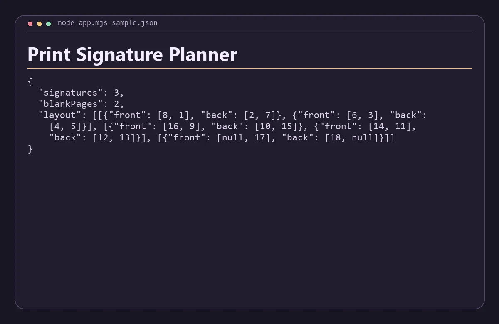

# Print Signature Planner

Lay out front and back page pairs for folded booklet signatures, including blank padding.



## Run

Install Node.js 22 or newer. Run these commands from the repository root.

```sh
node app.mjs sample.json
```

Replace `sample.json` with a JSON file following the same structure. The app prints a JSON report to standard output.

Supply page count and a maximum signature size divisible by four. The final signature is padded only to the next whole sheet. Read left and right in the printer's viewing orientation and proof duplex settings with one sheet.

## Verify

Run `python check.py` with Python 3.11 or newer after the build step when applicable. The check verifies the bundled scenario and confirms that an invalid input returns an error.
